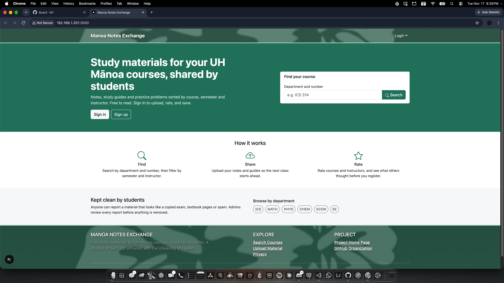
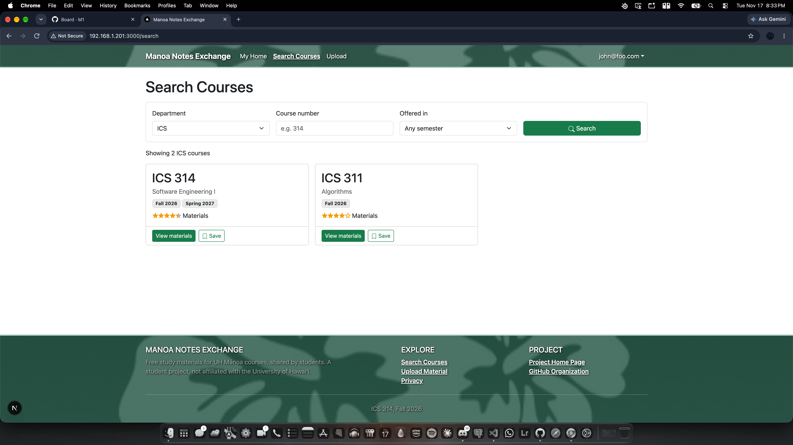
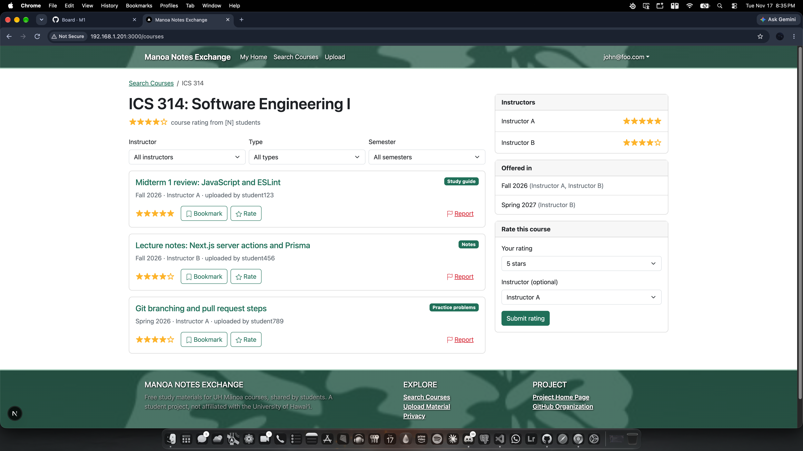
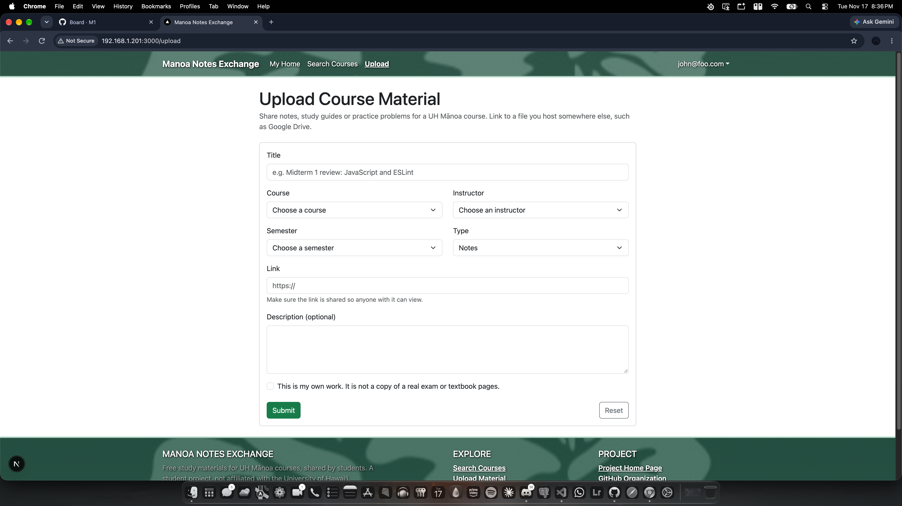
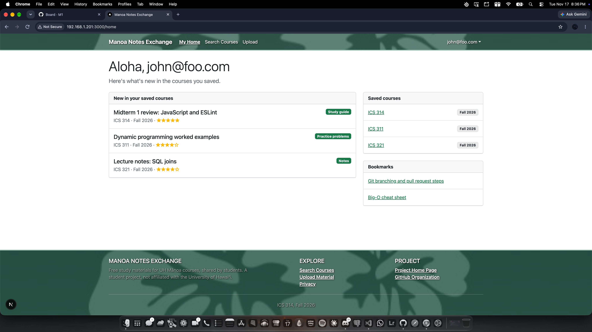
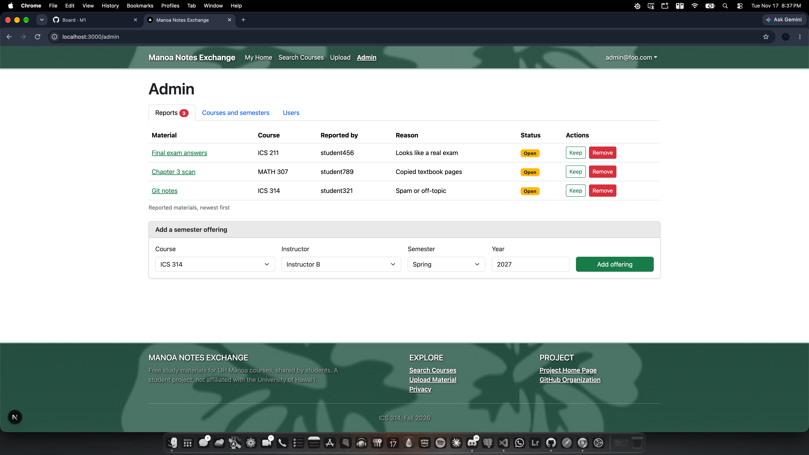
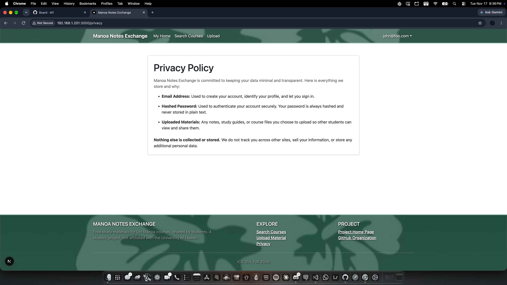

# Milestone 1 UI Mockups

This document showcases the Milestone 1 UI mockup pages implemented for **Mānoa Notes Exchange**.

## 1. Landing Page (`/`)
Overview of the platform, key features, and quick navigation for UH Mānoa students.

## 2. Search Courses (`/search`)
Filter and browse UH Mānoa courses to find shared study guides and lecture notes.

## 3. Browse Course Material (`/courses`)
View uploaded study materials, descriptions, and resources associated with a course.

## 4. Upload Course Material (`/upload`)
Form interface allowing authenticated students to submit new notes and study resources.

## 5. User Home (`/home`)
Personalized dashboard displaying a student's saved courses and uploaded materials.

## 6. Admin Page (`/admin`)
Administrative moderation view for managing users, courses, and flagged uploads.

## 7. Privacy Page (`/privacy`)
Platform data privacy guidelines and academic integrity expectations for UH Mānoa users.

